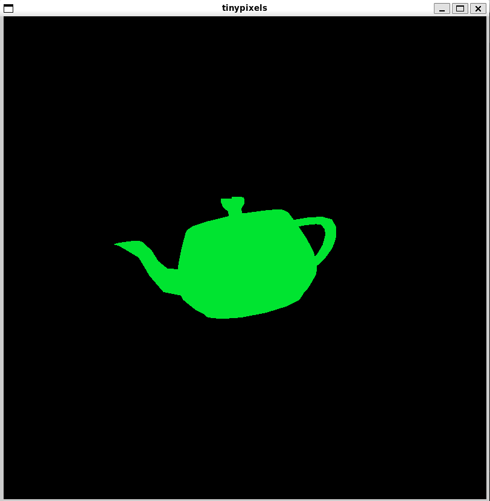

# tinypixels

basic CPU renderer written in C with raylib. simulates the graphics processing pipeline but on the CPU. so it is very slow.

## Features

- load and display obj models
- simulates vertex shading, rasterization in CPU
- can perform projection, translation and rotation around axes
- depth buffer testing

## Built With

- uses raylib to create window and for vector operations
- vertex shading, rasterization and final drawing is done by us

## Limitations
- it does not use the GPU, so it is extremely slow
- still not optimised to make best use of CPU
